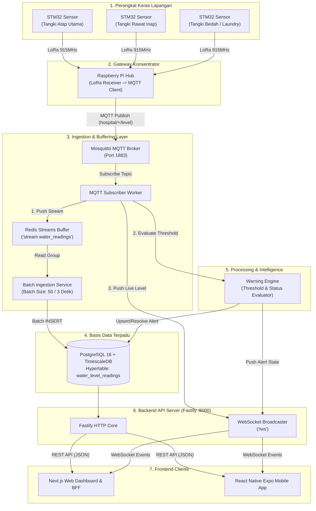
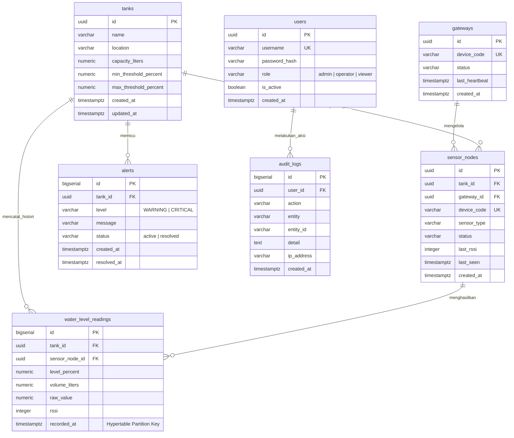
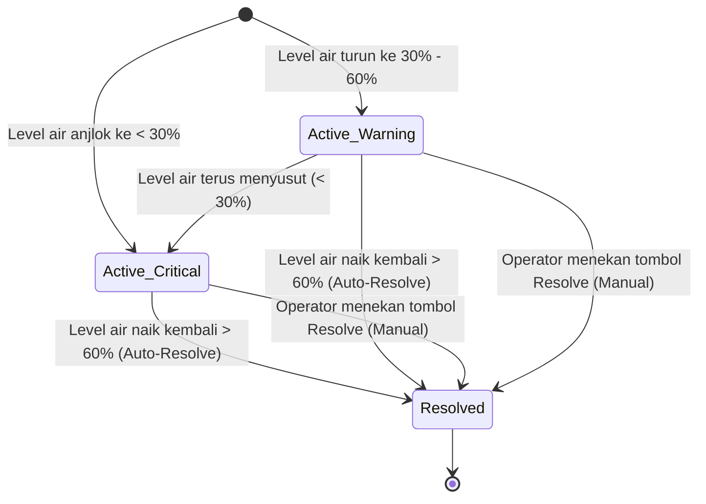

# 📋 Product Requirements Document (PRD) & Technical Architecture
# Integrated Hospital Water Tank Monitoring & Early Warning System (RSA UGM)

> **Repositori Inti Backend:** `backend-rsa-ugm` (Status: *READ ONLY* & *Single Source of Truth*)  
> **Repositori Dokumentasi & Master Context:** `frontend-documentation-rsa-ugm`  
> **Arsitektur Sistem:** IoT Time-Series Ingestion & Decoupled Multi-Platform Service  
> **Teknologi Backend:** Node.js 22 LTS, TypeScript, Fastify v5, TimescaleDB (PostgreSQL), Redis Streams, Mosquitto MQTT, WebSocket, Drizzle ORM  
> **Infrastruktur:** Docker Compose Multi-Container (Postgres+TimescaleDB, Redis, Mosquitto MQTT, Fastify Service)  
> **Fokus Dokumen Ini:** Spesifikasi Kebutuhan & Fondasi Backend (BE-First Approach) sebagai acuan kontrak kerja tim Frontend (Web & Mobile).

---

## 1. Deskripsi Singkat, Latar Belakang & Ruang Lingkup

### 1.1 Latar Belakang & Problem Statement
Rumah Sakit Akademik Universitas Gadjah Mada (RSA UGM) memiliki kebutuhan pasokan air bersih yang sangat vital dan sensitif terhadap fluktuasi level air untuk menunjang operasional medis (Unit Rawat Inap, Instalasi Bedah Sentral, Unit Hemodialisa, Ruang Sterilisasi/CSSD, hingga unit Laundry dan Dapur Medis).

Kendala operasional di lapangan:
1. **Inspeksi Manual Berisiko:** Petugas fasilitas harus naik ke atap gedung (*rooftop*) beberapa kali sehari untuk memeriksa fisik tangki air.
2. **Ketiadaan Early Warning:** Penurunan debit atau kegagalan pengisian tangki baru disadari saat air sudah menipis atau kran di ruang medis kering.
3. **Data Tercecer:** Tidak adanya data time-series historis yang akurat untuk evaluasi fluktuasi konsumsi air per hari/minggu.

Sistem ini hadir untuk mengotomasi pemantauan ketinggian air secara **terpusat, akurat, dan berbasis waktu-nyata (*realtime*)**, dilengkapi dengan **Warning Engine** cerdas yang mendeteksi penurunan debit air sebelum terjadi krisis layanan.

### 1.2 Batasan Ruang Lingkup (Scope & Boundaries)
* **Status Scope:** Sistem ini berfokus murni sebagai **Monitoring & Early Warning System** (pembacaan level air, penyimpanan time-series, deteksi anomali persentase, dan pengiriman sinyal peringatan aktif ke dashboard).
* **Scope Boundary (TIDAK ADA OTOMASI AKTUATOR):** Jalur aktuasi otomatis (menghidupkan/mematikan pompa atau buka-tutup solenoid valve secara remote) **secara tegas ditiadakan** demi keamanan infrastruktur fisik rumah sakit. Frontend tidak boleh membuat kendali tombol pompa atau aksi aktuator apa pun di luar kontrak yang disediakan Backend.

### 1.3 Glosarium Terminologi
* **Tank (`tanks`):** Entitas master tangki penampung air fisik di gedung rumah sakit beserta kapasitas dan batas ambang bahaya.
* **Sensor Node (`sensor_nodes`):** Modul sensor STM32 terpasang di masing-masing tangki yang mengukur jarak permukaan air menggunakan gelombang ultrasonik.
* **Gateway (`gateways`):** Perangkat konsentrator hub (Raspberry Pi) yang menerima pancaran radio LoRa dari seluruh STM32 lalu meneruskannya ke broker MQTT backend via protokol TCP/IP.
* **Reading (`water_level_readings`):** Rekaman log pengukuran time-series (persentase level air, estimasi volume liter, dan timestamp pengujian).
* **Warning Engine:** Mesin evaluasi aturan otomatis di backend yang mengecek level air secara terus-menerus dan mengelola siklus hidup status peringatan.
* **Alert (`alerts`):** Entitas peringatan bahaya (*WARNING* atau *CRITICAL*) saat ketinggian air berada di bawah batas ambang normal.
* **Audit Log (`audit_logs`):** Rekaman audit jejak aktivitas sistem dan pengguna (login, manipulasi master tangki, resolusi peringatan).

---

## 2. Tech Stack & Topologi Arsitektur Backend

### 2.1 Spesifikasi Tech Stack Backend

| Komponen / Layer | Teknologi | Peran & Alasan Pemilihan |
| :--- | :--- | :--- |
| **Runtime & Bahasa** | Node.js v22 LTS & TypeScript | Type-safety penuh, performa I/O tinggi, ekosistem IoT matang |
| **HTTP Web Framework** | Fastify v5 | Latensi rendah, schema validation bawaan, overhead minimal |
| **Database Relasional** | PostgreSQL 16 | Penyimpanan data relasional terstruktur (users, tanks, gateways) |
| **Time-Series Extension** | TimescaleDB | Hypertable teroptimasi untuk query grafik 24 jam & retensi data masif |
| **Queue & Buffering** | Redis Streams | Meredam lonjakan (*burst*) pesan MQTT sebelum batch insert ke DB |
| **IoT Protocol & Broker** | Eclipse Mosquitto (MQTT) | Komunikasi hemat bandwidth dari hub Raspberry Pi |
| **Realtime Channel** | WebSocket (`@fastify/websocket`) | Push realtime level air dan alert baru ke Web & Mobile |
| **ORM / Data Mapper** | Drizzle ORM | Query builder type-safe tanpa overhead ORM tradisional |
| **Validasi Skema** | Zod | Validasi payload MQTT, request body REST API, dan env config |
| **Keamanan & Autentikasi**| JWT (`@fastify/jwt`) & SHA-256 | Autentikasi token stateless dengan 3 Role (Admin, Operator, Viewer) |
| **Dokumentasi API** | Fastify Swagger & Scalar | OpenAPI 3.0 spec interaktif di endpoint `/docs` |

### 2.2 Arsitektur Aliran Data (Field to Dashboard)



---

## 3. Daftar Fitur Lengkap (Feature List Breakdown)

Backend menyediakan 8 modul fitur fungsional utama yang siap dikonsumsi oleh antarmuka Web dan Mobile:

### 3.1 Matriks Hak Akses Peran Pengguna (RBAC Matrix)

| Kode Fitur | Nama Fitur | Admin | Operator | Viewer |
| :--- | :--- | :---: | :---: | :---: |
| **F-01** | **Live Monitoring Level Air** (Realtime overview via REST & WS) | ✅ | ✅ | ✅ |
| **F-02** | **Histori Time-Series & Grafik 24 Jam** (Query histori & agregasi) | ✅ | ✅ | ✅ |
| **F-03** | **Sistem Deteksi Peringatan (Alerts)** (Melihat log alert aktif) | ✅ | ✅ | ✅ |
| **F-04** | **Penyelesaian Alert (Resolve / Acknowledge)** (Tandai alert beres) | ✅ | ✅ | ❌ |
| **F-05** | **Pemantauan Perangkat (Gateways & Sensor Nodes)** (Status LoRa/RPi) | ✅ | ✅ | ✅ |
| **F-06** | **Manajemen Master Tangki** (Tambah, Ubah Threshold, Hapus) | ✅ | ❌ | ❌ |
| **F-07** | **Manajemen Pengguna (User Management)** (CRUD Akun, Role, Reset) | ✅ | ❌ | ❌ |
| **F-08** | **Audit Log & Ekspor Laporan** (Lihat audit trail & download CSV) | ✅ | ✅ *(Lihat Saja)* | ❌ |

---

### 3.2 Rincian Deskripsi Fitur Fungsional

#### `F-01`: Live Monitoring Level Air Terpusat
* **Tujuan:** Menyajikan persentase ketinggian air (0-100%), estimasi volume (Liter), status kesehatan tangki, dan sinyal radio RSSI terakhir untuk setiap tangki.
* **Dukungan Backend:** 
  * `GET /api/tanks`: Mengembalikan snapshot seluruh tangki lengkap dengan pembacaan sensor terbaru (`latestReading`) dan alert aktif (`activeAlert`).
  * `GET /api/readings/latest`: Polling cepat status level seluruh tangki.
  * Realtime Broadcast via WebSocket event `LEVEL_UPDATE`.

#### `F-02`: Histori Time-Series & Analisis Grafik 24 Jam
* **Tujuan:** Menyediakan data berkala untuk komponen grafik garis interaktif di dashboard Web dan Mobile.
* **Dukungan Backend:**
  * `GET /api/readings/tank/:id?range=24h`: Mengambil histori pembacaan per tangki.
  * `GET /api/readings/multi-tank?hours=24`: Mengambil histori multi-tangki sekaligus dengan agregasi interval 1 jam untuk performa visualisasi instan tanpa membuat browser lag.

#### `F-03`: Deteksi Peringatan & Early Warning (Alert Engine)
* **Tujuan:** Memberi sinyal bahaya seketika saat volume air anomali atau mendekati habis.
* **Dukungan Backend:**
  * Penilaian otomatis Warning Engine setiap paket data MQTT masuk.
  * `GET /api/alerts?status=active`: Daftar alert yang sedang terjadi dan butuh tindakan.
  * Realtime Broadcast via WebSocket event `ALERT_TRIGGERED`.

#### `F-04`: Penyelesaian Peringatan (Alert Resolution)
* **Tujuan:** Memungkinkan petugas di lapangan atau operator ruang kontrol menandai bahwa kondisi bahaya sudah ditangani.
* **Dukungan Backend:**
  * `PATCH /api/alerts/:id/resolve`: Menutup alert secara manual dan mencatat waktu `resolvedAt`.
  * Pencatatan otomatis ke tabel `audit_logs`.
  * Realtime Broadcast via WebSocket event `ALERT_RESOLVED`.

#### `F-05`: Status Konektivitas & Kesehatan Perangkat
* **Tujuan:** Memantau apakah modul sensor STM32 dan Gateway Raspberry Pi aktif atau mengalami gangguan komunikasi radio.
* **Dukungan Backend:**
  * `GET /api/gateways`: Informasi status gateway (`online`/`offline`), heartbeat terakhir, dan daftar node yang terhubung.
  * `GET /api/nodes`: Status spesifik node sensor (`active`, `offline`, `error`), RSSI terakhir, dan `lastSeen`.
  * Realtime Broadcast via WebSocket event `NODE_STATUS`.

#### `F-06`: Manajemen Master Tangki & Konfigurasi Threshold
* **Tujuan:** Memberikan wewenang kepada Administrator untuk mendaftarkan tangki baru, mengubah kapasitas, dan menyetel batas peringatan minimum/maksimum.
* **Dukungan Backend:**
  * `POST /api/tanks`, `PUT /api/tanks/:id`, `DELETE /api/tanks/:id`.
  * Proteksi RBAC ketat (hanya role `admin`).

#### `F-07`: Manajemen Pengguna & Keamanan (AAA)
* **Tujuan:** Mengelola akun operator, hak akses, dan pergantian kata sandi.
* **Dukungan Backend:**
  * Autentikasi stateless menggunakan JWT: `POST /api/auth/login`, `GET /api/auth/me`.
  * CRUD Akun: `GET /api/users`, `POST /api/users`, `PATCH /api/users/:id`, `DELETE /api/users/:id`.

#### `F-08`: Rekaman Jejak Audit & Ekspor Dokumen
* **Tujuan:** Menjamin kepatuhan (*compliance*) operasional rumah sakit dan transparansi tindakan operator.
* **Dukungan Backend:**
  * `GET /api/audit-logs`: Rekaman seluruh aksi kritis sistem beserta alamat IP pengakses.
  * `GET /api/reports/readings/export?tankId=...`: Unduh riwayat pembacaan sensor dalam format CSV.
  * `GET /api/reports/alerts/export`: Unduh riwayat peringatan alert dalam format CSV.

---

## 4. Skema Basis Data & Model Relasional

Penyimpanan backend menggunakan **PostgreSQL 16** dengan tabel log sensor yang dikonfigurasi sebagai **Hypertable TimescaleDB** berbasis kolom waktu `recorded_at`.



### Data Seed Akun Demo (Local Development & Testing)
Kredensial bawaan yang disiapkan otomatis oleh script seed database (`npm run db:init`):
* **Admin:** Username: `admin` | Password: `admin123` | Role: `admin`
* **Default Gateway:** Device Code: `GW-HUB-01`
* **Default Tanks:** 
  1. `Tangki Atap Gedung Utama` (Kapasitas: 10.000 L, Min Threshold: 30%, Max Threshold: 90%)
  2. `Tangki Gedung Rawat Inap` (Kapasitas: 8.000 L, Min Threshold: 30%, Max Threshold: 90%)

---

## 5. Logika Bisnis & Mesin Peringatan (Warning Engine)

### 5.1 Matriks Ambang Batas Air (Threshold Matrix)

Evaluasi status kesehatan tangki dilakukan secara otomatis pada setiap pembacaan sensor yang diterima dari MQTT:

| Level Air (%) | Status Kategori | Kode Warna UI | Aksi Warning Engine |
| :--- | :--- | :--- | :--- |
| **$> 60.00\%$** | **NORMAL** | Hijau (`#10B981`) | Jika ada alert aktif sebelumnya untuk tangki ini, sistem **otomatis menyelesaikan (auto-resolve)** alert tersebut (`status: resolved`). |
| **$30.00\% - 60.00\%$** | **WARNING** | Kuning / Amber (`#F59E0B`) | Memicu entri alert baru dengan tingkat `WARNING`. Menyiagakan operator bahwa volume air mulai menurun. |
| **$< 30.00\%$** | **CRITICAL** | Merah (`#EF4444`) | Memicu entri alert berstatus `CRITICAL`. Notifikasi darurat harus segera ditampilkan di dashboard untuk tindakan darurat. |

### 5.2 Matriks Transisi Status Peringatan (Alert State Lifecycle)



* **Pencegahan Spam Peringatan (De-duplication):** Jika tangki sedang berada dalam status `WARNING` dan pembacaan sensor berikutnya masih bernilai `WARNING`, sistem **tidak akan membuat baris alert baru**. Sistem hanya mempertahankan 1 alert berstatus `active` per tangki.

---

## 6. Spesifikasi Kontrak REST API (API Contract)

### 6.0 Master Checklist API yang Wajib Dicover Frontend

Berikut adalah daftar lengkap (matriks periksa) seluruh endpoint API yang disediakan backend, dipetakan langsung ke platform frontend (**Web Next.js** dan **Mobile Expo**), tingkat prioritas implementasi, serta komponen UI yang membutuhkannya:

| No | Modul | Method | Endpoint Path | Target Platform | Min. Role | Kebutuhan Komponen / Screen UI | Prioritas |
| :-: | :--- | :---: | :--- | :---: | :---: | :--- | :---: |
| 1 | **System** | `GET` | `/health` | Web & Mobile | Public | Network Status Indicator / Server Ping | `P1` |
| 2 | **Auth** | `POST` | `/api/auth/login` | Web & Mobile | Public | Halaman/Layar Login, Session Bootstrapping | `P0` |
| 3 | **Auth** | `GET` | `/api/auth/me` | Web & Mobile | Viewer | Profil User, Header/Sidebar, Role Check | `P0` |
| 4 | **Tanks** | `GET` | `/api/tanks` | Web & Mobile | Viewer | Dashboard Overview Grid, Card List Tangki | `P0` |
| 5 | **Tanks** | `GET` | `/api/tanks/:id` | Web & Mobile | Viewer | Halaman/Modal Detail Tangki & Gauge Air | `P0` |
| 6 | **Tanks** | `GET` | `/api/tanks/:id/readings` | Web & Mobile | Viewer | Komponen Grafik Time-Series Tangki Tunggal | `P0` |
| 7 | **Tanks** | `POST` | `/api/tanks` | Web (Admin) | Admin | Form Tambah Master Tangki Baru | `P1` |
| 8 | **Tanks** | `PUT` / `PATCH` | `/api/tanks/:id` | Web (Admin) | Admin | Form Edit Kapasitas & Threshold Tangki | `P1` |
| 9 | **Tanks** | `DELETE` | `/api/tanks/:id` | Web (Admin) | Admin | Tombol Aksi Hapus Master Tangki | `P2` |
| 10 | **Readings**| `GET` | `/api/readings/latest` | Web & Mobile | Viewer | Polling Fallback Quick Level Widget | `P1` |
| 11 | **Readings**| `GET` | `/api/readings/tank/:id` | Web & Mobile | Viewer | Analisis Historis Pembacaan Sensor Tangki | `P1` |
| 12 | **Readings**| `GET` | `/api/readings/multi-tank` | Web Only | Viewer | Grafik Perbandingan Multi-Tangki (24 Jam) | `P1` |
| 13 | **Alerts** | `GET` | `/api/alerts` | Web & Mobile | Viewer | Banner/Notifikasi Peringatan, Halaman Alert | `P0` |
| 14 | **Alerts** | `PATCH` / `PUT` | `/api/alerts/:id/resolve`| Web & Mobile | Operator | Tombol Aksi "Resolve / Selesaikan Alert" | `P0` |
| 15 | **Devices** | `GET` | `/api/gateways` | Web & Mobile | Viewer | Status Koneksi Gateway RPi & Node LoRa | `P1` |
| 16 | **Devices** | `GET` | `/api/nodes` | Web & Mobile | Viewer | Status Modul Sensor STM32 (Baterai/RSSI) | `P1` |
| 17 | **Users** | `GET` | `/api/users` | Web (Admin) | Admin | Tabel Manajemen Daftar Pengguna | `P1` |
| 18 | **Users** | `POST` | `/api/users` | Web (Admin) | Admin | Form Pendaftaran Akun Operator/Viewer | `P1` |
| 19 | **Users** | `PATCH` / `PUT` | `/api/users/:id` | Web (Admin) | Admin | Modal Edit Peran, Status & Reset Password | `P1` |
| 20 | **Users** | `DELETE` | `/api/users/:id` | Web (Admin) | Admin | Tombol Nonaktifkan Akun Pengguna | `P2` |
| 21 | **Audit** | `GET` | `/api/audit-logs` | Web (Admin) | Operator | Halaman Log Riwayat Aktivitas & Keamanan | `P2` |
| 22 | **Reports** | `GET` | `/api/reports/readings/export` | Web Only | Operator | Tombol Unduh Laporan Sensor (.CSV) | `P2` |
| 23 | **Reports** | `GET` | `/api/reports/alerts/export` | Web Only | Operator | Tombol Unduh Laporan Riwayat Alert (.CSV) | `P2` |
| 24 | **Realtime**| `WS` | `ws://<host>:8000/ws` | Web & Mobile | Viewer | Realtime Level Stream, Live Alert & Status | `P0` |

> 📌 **Catatan Prioritas Frontend:**
> * **`P0` (Critical - Core MVP):** Wajib selesai terlebih dahulu agar monitoring tangki, login, tampilan data level air, dan sistem peringatan darurat berfungsi secara penuh di Web & Mobile.
> * **`P1` (High - Functional Expansion):** Fitur analitik grafik 24 jam, status perangkat gateway/node, serta form pengelolaan master tangki dan pengguna.
> * **`P2` (Secondary - Administrative & Compliance):** Fitur pelengkap seperti ekspor laporan spreadsheet CSV dan viewer audit log.

---

### 6.1 Konvensi Global
* **Base URL:** `http://localhost:8000`
* **Swagger Documentation URL:** `http://localhost:8000/docs/`
* **Format Timestamp:** ISO 8601 UTC (`YYYY-MM-DDTHH:mm:ss.sssZ`)
* **Standar Envelope Respons Sukses (HTTP 2xx):**
  ```json
  {
    "success": true,
    "data": { ... } // atau array [ ... ]
  }
  ```
* **Standar Envelope Respons Gagal (HTTP 4xx / 5xx):**
  ```json
  {
    "success": false,
    "message": "Deskripsi kesalahan yang terjadi",
    "errors": { ... } // Opsional: rincian validasi field jika status 400
  }
  ```

---

### 6.2 Modul Health & Status Server

#### `GET /health`
* **Deskripsi:** Health check status koneksi database PostgreSQL, Redis, dan total klien WebSocket yang aktif.
* **Autentikasi:** Publik
* **Respons Berhasil (`200 OK`):**
  ```json
  {
    "status": "healthy",
    "services": {
      "database": "up",
      "redis": "up"
    },
    "websocketClients": 4,
    "timestamp": "2026-10-22T03:00:00.000Z"
  }
  ```

---

### 6.3 Modul Autentikasi Pengguna

#### `POST /api/auth/login`
* **Deskripsi:** Memvalidasi kredensial dan menerbitkan JWT token.
* **Autentikasi:** Publik
* **Request Body:**
  ```json
  {
    "username": "admin",
    "password": "admin123"
  }
  ```
* **Respons Berhasil (`200 OK`):**
  ```json
  {
    "success": true,
    "data": {
      "token": "eyJhbGciOiJIUzI1NiIsInR5cCI6IkpXVCJ9...",
      "user": {
        "id": "7b89f5c2-3e21-4f90-a548-d3c267b14002",
        "username": "admin",
        "role": "admin",
        "isActive": true
      }
    }
  }
  ```

#### `GET /api/auth/me`
* **Deskripsi:** Mengambil informasi profil pengguna yang sedang login.
* **Autentikasi:** Wajib Bearer Token (`Authorization: Bearer <token>`)
* **Respons Berhasil (`200 OK`):**
  ```json
  {
    "success": true,
    "data": {
      "id": "7b89f5c2-3e21-4f90-a548-d3c267b14002",
      "username": "admin",
      "role": "admin",
      "isActive": true,
      "createdAt": "2026-09-14T06:00:00.000Z"
    }
  }
  ```

---

### 6.4 Modul Monitoring & Master Tangki

#### `GET /api/tanks`
* **Deskripsi:** Mengambil seluruh daftar tangki beserta pembacaan sensor terbaru, alert aktif, dan informasi node terpasang.
* **Autentikasi:** Publik / Opsional Bearer Token
* **Respons Berhasil (`200 OK`):**
  ```json
  {
    "success": true,
    "data": [
      {
        "id": "e0a7e584-6091-4560-b6aa-cf4a852875a1",
        "name": "Tangki Atap Gedung Utama",
        "location": "Atap Gedung A (Utama), Lantai 5",
        "capacityLiters": "10000.00",
        "minThresholdPercent": "30.00",
        "maxThresholdPercent": "90.00",
        "createdAt": "2026-09-14T06:02:15.123Z",
        "updatedAt": "2026-09-14T06:02:15.123Z",
        "latestReading": {
          "id": 14205,
          "tankId": "e0a7e584-6091-4560-b6aa-cf4a852875a1",
          "sensorNodeId": "c4d18723-5e72-46fa-b12e-188998abcf12",
          "levelPercent": "72.40",
          "volumeLiters": "7240.00",
          "rssi": -74,
          "recordedAt": "2026-10-22T03:00:00.000Z"
        },
        "activeAlert": null,
        "sensorNode": {
          "id": "c4d18723-5e72-46fa-b12e-188998abcf12",
          "deviceCode": "NODE-TNK-01",
          "status": "active",
          "lastRssi": -74,
          "lastSeen": "2026-10-22T03:00:00.000Z"
        }
      }
    ]
  }
  ```

#### `GET /api/tanks/:id`
* **Deskripsi:** Detail 1 tangki spesifik beserta histori 24 jam terakhir dan alert aktif.
* **Autentikasi:** Publik / Opsional Bearer Token

#### `POST /api/tanks`
* **Deskripsi:** Mendaftarkan tangki baru ke dalam sistem.
* **Autentikasi:** Khusus Role `admin`
* **Request Body:**
  ```json
  {
    "name": "Tangki Instalasi Bedah Sentral",
    "location": "Gedung Bedah Lantai 4",
    "capacityLiters": 12000,
    "minThresholdPercent": 35,
    "maxThresholdPercent": 95
  }
  ```
* **Respons Berhasil (`201 Created`):** Objek data tangki yang berhasil disimpan.

#### `PUT /api/tanks/:id`
* **Deskripsi:** Memperbarui data tangki atau batas threshold peringatan.
* **Autentikasi:** Khusus Role `admin`

#### `DELETE /api/tanks/:id`
* **Deskripsi:** Menghapus tangki dari sistem (jika tidak memiliki pembacaan aktif).
* **Autentikasi:** Khusus Role `admin`

---

### 6.5 Modul Pembacaan Sensor (Readings & History)

#### `GET /api/readings/latest`
* **Deskripsi:** Mengambil pembacaan level air paling baru dari semua tangki.
* **Respons Berhasil (`200 OK`):**
  ```json
  {
    "success": true,
    "data": [
      {
        "tankId": "e0a7e584-6091-4560-b6aa-cf4a852875a1",
        "tankName": "Tangki Atap Gedung Utama",
        "levelPercent": "72.40",
        "volumeLiters": "7240.00",
        "recordedAt": "2026-10-22T03:00:00.000Z"
      }
    ]
  }
  ```

#### `GET /api/readings/tank/:id`
* **Deskripsi:** Mengambil data histori log untuk grafik tangki tunggal.
* **Query Parameters:**
  * `range` (opsional): `"24h"`, `"7d"`, `"30d"` (default: `"24h"`).
  * `limit` (opsional): batas baris data (default: 100).

#### `GET /api/readings/multi-tank`
* **Deskripsi:** Mengambil histori agregasi seluruh tangki (interval 1 jam) selama 24 jam terakhir. Dioptimalkan untuk komponen perbandingan multi-grafik di dashboard Web.
* **Query Parameters:** `hours` (default: 24).
* **Respons Berhasil (`200 OK`):**
  ```json
  {
    "success": true,
    "data": [
      {
        "timeBucket": "2026-10-22T02:00:00.000Z",
        "tankId": "e0a7e584-6091-4560-b6aa-cf4a852875a1",
        "tankName": "Tangki Atap Gedung Utama",
        "avgLevel": 74.2,
        "avgVolume": 7420
      }
    ]
  }
  ```

---

### 6.6 Modul Peringatan & Alerts

#### `GET /api/alerts`
* **Deskripsi:** Mengambil daftar riwayat alert.
* **Query Parameters:**
  * `status` (opsional): `"active"` atau `"resolved"`.
  * `tankId` (opsional): Filter berdasarkan UUID tangki tertentu.
  * `limit` (opsional, default: 50).
* **Respons Berhasil (`200 OK`):**
  ```json
  {
    "success": true,
    "data": [
      {
        "id": 89,
        "tankId": "e0a7e584-6091-4560-b6aa-cf4a852875a1",
        "tankName": "Tangki Atap Gedung Utama",
        "level": "CRITICAL",
        "message": "Level air kritis: 28.5% (di bawah batas 30.0%)",
        "status": "active",
        "createdAt": "2026-10-22T02:45:10.000Z",
        "resolvedAt": null
      }
    ]
  }
  ```

#### `PATCH /api/alerts/:id/resolve`
* **Deskripsi:** Menyelesaikan peringatan bahaya secara manual oleh operator/admin.
* **Autentikasi:** Wajib Token (Role `admin` atau `operator`)
* **Respons Berhasil (`200 OK`):**
  ```json
  {
    "success": true,
    "data": {
      "id": 89,
      "status": "resolved",
      "resolvedAt": "2026-10-22T03:05:12.000Z"
    }
  }
  ```

---

### 6.7 Modul Perangkat (Gateways & Nodes)

#### `GET /api/gateways`
* **Deskripsi:** Daftar seluruh Gateway Raspberry Pi beserta status online dan node-node sensor yang terhubung.
* **Respons Berhasil (`200 OK`):**
  ```json
  {
    "success": true,
    "data": [
      {
        "id": "11111111-2222-3333-4444-555555555555",
        "deviceCode": "GW-HUB-01",
        "status": "online",
        "lastHeartbeat": "2026-10-22T03:00:00.000Z",
        "nodes": [
          {
            "id": "c4d18723-5e72-46fa-b12e-188998abcf12",
            "deviceCode": "NODE-TNK-01",
            "tankName": "Tangki Atap Gedung Utama",
            "status": "active",
            "lastRssi": -74,
            "lastSeen": "2026-10-22T03:00:00.000Z"
          }
        ]
      }
    ]
  }
  ```

#### `GET /api/gateways/:deviceCode/sync`
* **Deskripsi:** Endpoint internal khusus sinkronisasi perangkat Raspberry Pi ke Backend saat pertama kali boot.
* **Autentikasi:** Header `x-gateway-key: <GATEWAY_SYNC_KEY>`

---

### 6.8 Modul Manajemen Pengguna (Admin)

* `GET /api/users`: Menampilkan seluruh daftar pengguna (Admin only).
* `POST /api/users`: Mendaftarkan akun operator/viewer baru dengan body `{ username, password, role }`.
* `PATCH /api/users/:id`: Memperbarui peran (`role`), status aktif (`isActive`), atau reset `password`.
* `DELETE /api/users/:id`: Menonaktifkan akun pengguna (`isActive: false`).

---

### 6.9 Modul Audit Trail & Ekspor Laporan

#### `GET /api/audit-logs`
* **Deskripsi:** Riwayat rekam jejak aksi pengguna di sistem.
* **Query Parameters:** `page`, `limit`, `action`, `userId`.
* **Respons Berhasil (`200 OK`):**
  ```json
  {
    "success": true,
    "data": [
      {
        "id": 142,
        "action": "LOGIN",
        "entity": "users",
        "entityId": "7b89f5c2-3e21-4f90-a548-d3c267b14002",
        "detail": "Pengguna admin berhasil login",
        "ipAddress": "192.168.1.100",
        "createdAt": "2026-10-22T01:30:00.000Z"
      }
    ],
    "total": 142
  }
  ```

#### `GET /api/reports/readings/export` & `GET /api/reports/alerts/export`
* **Deskripsi:** Mengunduh file laporan dalam format `.csv` (Content-Type: `text/csv`).
* **Query Parameters:** `tankId`, `from` (ISO date), `to` (ISO date).

---

## 7. Spesifikasi Protokol WebSocket Realtime

Frontend dapat membuka koneksi WebSocket persisten untuk menerima pembaruan instan tanpa harus melakukan request HTTP berulang kali:

* **URL WebSocket:** `ws://localhost:8000/ws`
* **Protokol:** JSON Event Streaming

### Format Event WebSocket

#### 1. Event `CONNECTED` (Saat Pertama Terhubung)
Dikirim oleh server segera setelah koneksi WebSocket berhasil dibuka:
```json
{
  "event": "CONNECTED",
  "data": {
    "clientId": "ws-client-1698000000",
    "timestamp": "2026-10-22T03:00:00.000Z"
  }
}
```

#### 2. Event `LEVEL_UPDATE` (Ketinggian Air Berubah)
Dipancarkan setiap kali pembacaan sensor baru berhasil diolah oleh Worker:
```json
{
  "event": "LEVEL_UPDATE",
  "data": {
    "tankId": "e0a7e584-6091-4560-b6aa-cf4a852875a1",
    "tankName": "Tangki Atap Gedung Utama",
    "levelPercent": "72.40",
    "volumeLiters": "7240.00",
    "rssi": -74,
    "recordedAt": "2026-10-22T03:00:00.000Z"
  }
}
```

#### 3. Event `ALERT_TRIGGERED` (Bahaya Baru Terdeteksi)
Dipancarkan saat volume air masuk kategori `WARNING` atau `CRITICAL`:
```json
{
  "event": "ALERT_TRIGGERED",
  "data": {
    "id": 89,
    "tankId": "e0a7e584-6091-4560-b6aa-cf4a852875a1",
    "tankName": "Tangki Atap Gedung Utama",
    "level": "CRITICAL",
    "message": "Level air kritis: 28.5% (di bawah batas 30.0%)",
    "createdAt": "2026-10-22T03:00:00.000Z"
  }
}
```

#### 4. Event `ALERT_RESOLVED` (Kondisi Bahaya Selesai)
Dipancarkan saat alert diselesaikan secara manual oleh operator atau auto-resolve oleh sistem:
```json
{
  "event": "ALERT_RESOLVED",
  "data": {
    "id": 89,
    "tankId": "e0a7e584-6091-4560-b6aa-cf4a852875a1",
    "resolvedAt": "2026-10-22T03:05:00.000Z"
  }
}
```

#### 5. Event `NODE_STATUS` (Status Perangkat)
Dipancarkan jika node sensor STM32 offline atau mengalami gangguan:
```json
{
  "event": "NODE_STATUS",
  "data": {
    "nodeId": "c4d18723-5e72-46fa-b12e-188998abcf12",
    "deviceCode": "NODE-TNK-01",
    "status": "active",
    "lastRssi": -74,
    "lastSeen": "2026-10-22T03:00:00.000Z"
  }
}
```

---

## 8. Infrastruktur & Orkestrasi Kontainer Backend

Seluruh service pendukung backend dikontainerisasi menggunakan `docker-compose.yml`:

```yaml
services:
  # 1. Database PostgreSQL dengan Ekstensi TimescaleDB
  postgres:
    image: timescale/timescaledb:latest-pg16
    ports:
      - "5432:5432"
    environment:
      POSTGRES_USER: postgres
      POSTGRES_PASSWORD: password123
      POSTGRES_DB: water_tank_db
    volumes:
      - pgdata:/var/lib/postgresql/data

  # 2. Redis untuk Buffer Ingestion & Pub/Sub
  redis:
    image: redis:7-alpine
    ports:
      - "6379:6379"

  # 3. Eclipse Mosquitto MQTT Broker
  mosquitto:
    image: eclipse-mosquitto:2
    ports:
      - "1883:1883"
    volumes:
      - ./mosquitto.conf:/mosquitto/config/mosquitto.conf

  # 4. Core Backend App (Fastify REST API & Worker)
  backend:
    build: .
    ports:
      - "8000:8000"
    depends_on:
      - postgres
      - redis
      - mosquitto
```

---

## 9. Matriks Pengujian Fungsional Backend (Test Matrix)

Backend dilengkapi script pengujian otomatis terpadu (`npm run test:api`) yang memverifikasi integritas endpoint:

| No | Modul Uji | Target Endpoint / Skrip | Ekspektasi Hasil |
| :-: | :--- | :--- | :--- |
| 1 | **Health Check** | `GET /health` | HTTP 200, database `up`, redis `up` |
| 2 | **Dokumentasi API** | `GET /docs/` | HTTP 200, menyajikan antarmuka Swagger/OpenAPI |
| 3 | **Autentikasi Valid** | `POST /api/auth/login` (`admin`/`admin123`) | HTTP 200, mengembalikan JWT Bearer Token |
| 4 | **Profil Terproteksi** | `GET /api/auth/me` (Dengan Token) | HTTP 200, payload user cocok dengan database |
| 5 | **Data Master Tangki**| `GET /api/tanks` | HTTP 200, array data tangki beserta status bacaan |
| 6 | **Daftar Node Sensor**| `GET /api/nodes` | HTTP 200, memverifikasi keterkaitan tangki & sensor |
| 7 | **Sync Gateway RPi** | `GET /api/gateways/GW-HUB-01/sync` | HTTP 200, header `x-gateway-key` terverifikasi |
| 8 | **Ekspor CSV Laporan**| `GET /api/reports/readings/export` | HTTP 200, header `Content-Type: text/csv` |
| 9 | **Audit Trail** | `GET /api/audit-logs` | HTTP 200, catatan aksi terdata di PostgreSQL |
| 10| **Simulasi IoT MQTT** | `npm run simulate` | Menerbitkan dummy data level air & mengecek warning |

---

## 10. Petunjuk Integrasi untuk Tim Frontend (Web & Mobile)

Sebagai acuan operasional bagi tim pengembang antarmuka:

1. **Jadikan BE Acuan Mutlak:** Seluruh nama field JSON mengikuti camelCase yang dikembalikan BE (`levelPercent`, `capacityLiters`, `minThresholdPercent`). Jangan mengubah nama properti ini tanpa persetujuan.
2. **Peran Next.js API Routes sebagai BFF:** Web frontend memanfaatkan Next.js App Router API Routes sebagai BFF untuk:
   * Menyimpan JWT Token di dalam **HTTP-only cookie** yang aman dari XSS.
   * Menjadi proksi agregasi request jika diperlukan.
3. **Penyimpanan Token di Mobile:** Aplikasi React Native Expo wajib menyimpan JWT token di media penyimpanan terenkripsi hardware (**`expo-secure-store`**), bukan di `AsyncStorage` biasa.
4. **Strategi Koneksi Realtime Dual-Mode:**
   * Lakukan *initial load* komponen kartu tangki via `GET /api/tanks`.
   * Buka WebSocket ke `ws://localhost:8000/ws`.
   * Saat menerima event `LEVEL_UPDATE`, perbarui state lokal tangki di Zustand store secara reaktif.
   * Jika koneksi WebSocket terputus (*disconnected*), lakukan *exponential backoff reconnect* dan gunakan *polling interval* (misal setiap 10-15 detik) sebagai jaring pengaman (*fallback*).
5. **Penanganan Error Terpadu:**
   * HTTP 401: Hapus sesi/token dan arahkan pengguna ke halaman Login.
   * HTTP 403: Tampilkan pesan *"Anda tidak memiliki hak otorisasi untuk aksi ini"*.
   * HTTP 404 / 500: Tampilkan UI Error Banner dengan tombol *Retry*.
